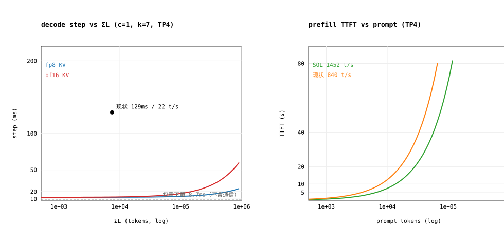

# 极限基线：Qwen3.8-27B-FP8 @ 4×Z100L（TP4 / PCIe 4.0 x16）

> **性质**：纯算术基线（SOL, speed-of-light），不含任何新负载。
> **复算**：`.venv/bin/python tools/dcu/sol_baseline.py`；`--svg docs/perf/sol-baseline.svg` 出图。
> **常量来源**：本机既有实测（`docs/perf/PERF1-results.md`、`.s22/S22_LONGCTX_DECODE.md`、
> `docs/archive/result/z100-12-p2p-acs-impact-result.md`）+ 厂商规格。标注沿用仓库惯例：
> **【规格】**、**【实测】**、**【推算】**。
> **看到实测与本文冲突时以实测为准**，然后把常量改回脚本 §`SOURCES`。

> ⚠️ **2026-10-25 已实测校准**：[SOL-MEASURED-20261025.md](SOL-MEASURED-20261025.md)（4 卡空闲，原始 JSON 在 `docs/perf/data/`）。
> prefill 的算法口径成立（1452 t/s；计入 AR 税后 **1208 t/s**）；
> **decode 的"8.7 ms"被推翻**——它隐含"权重按 copy 带宽读"，实测 GEMV 只有 197–292 GB/s。
> 校准后的单流 decode 是 **29.3 ms / 97 tok/s（stream GEMV）～37.1 ms / 76 tok/s（rocBLAS）**，
> 通信 per-op 实测钉在 **90 µs**。本文保留为**理论模型与公式推导**，数值以校准文档为准。

---

## 0. 一页结论

| 量 | 极限（SOL） | 现状（本机实测） | 差距 |
|---|---:|---:|---:|
| prefill | **1452 t/s**（理论）/ **1208 t/s**（含 AR 税，8k） | 840 t/s / 8.89 s | **1.4–1.7×** |
| decode 单步，c=1、7.5k、k=7 | **29.3 ms**（GEMV 414 GB/s + AR 90 µs/op；8.3 ms 是 copy 口径的理论梦） | 129 ms | **4.4×** |
| decode 单流（acc 2.84） | **76–97 tok/s** | 22 t/s | **3.5–4.4×** |
| decode 聚合封顶 | **1452 t/s**（≈15 路 ≈43 token/步 才饱和） | 未测到饱和点 | — |
| 长上下文 4×121k | 54.4 ms/步 → 209 tok/s | 线上 40–100 s/步 | ~10²–10³× |
| KV 容量 | 749k tokens（fp8）@ 4 KB/token/卡 | — | 121k ctx → 6 路 |

三条必须先修正的认知：

1. **这张卡上 FP8 不涨算力。** gfx906 无原生 `fp8`/`bf16` 指令（`v_cvt_f32_fp8` 全不存在），
   FP8 走 256-entry LDS LUT + `v_dot2_f32_f16` 仿真 ⇒ 算力峰值仍按 FP16 的
   20.2 TF/s【规格】/ 19.61 TF/s【实测】算。**FP8 在这里只值"权重字节减半"**，
   对 decode 是 2×，对 prefill 是 0。
2. **"20 TFLOPS FP16" 是 VALU 打包峰值**（60 CU × 64 lane × 4 FLOP × ~1.3 GHz），
   大 GEMM 实测 19.61 TF/s（4096³）≈ 97% 可达；但小 M/小 N 形状只有
   5.06–13 TF/s【实测】，这正是 prefill 只剩 58% 的原因。
3. **TP4 的通信瓶颈不是带宽，是 per-op 延迟 + SHM 路径。** 80 KB 消息在
   PCIe 4.0 x16（28.4 GB/s）上 ring 传输只要 **4.3 µs**，实测一次 all-reduce 的
   关键路径是 **72 µs**【实测】~**260 µs**【实测】⇒ 93–98% 是延迟/同步，不是搬数。
   （2026-10-25 独立复测：4 rank 80 KB **p50 = 90 µs**，且 10 KB 与 160 KB 同为
   90–100 µs ⇒ 地板是固定开销，140 次/步 = **12.6 ms**。）
   另外 RCCL 的 all-reduce 在 4 卡上**走 SHM，不走 P2P**，所以"P2P 28.4 GB/s 开着"
   ≠ "all-reduce 用上了 P2P"。



---

## 1. 输入与口径

| 量 | 值 | 出处 |
|---|---:|---|
| 模型 | Qwen3.8-27B 稠密，64 层 = 16 全注意力 + 48 GDN | 模型 config |
| 权重 | FP8 27 GB（TP4 → **6.75 GB/卡**） | 【实测】PROJ §10.1 |
| 每 token FLOPs | 54 GFLOP（TP4 → 13.5 GFLOP/rank） | 2×27e9 |
| hidden / K | 5120 | 【实测】kernel 形状 |
| KV / token / 卡 | **4 KB**（fp8）/ 16 KB（bf16 口径） | S22、PROJ §10.2 |
| GDN state / seq / 卡 | **36.9 MB**（48 层 × 12 v-head × 128 × 128 × fp32） | 【推算】config |
| FP16 峰值 | 20.2–24.5 TF/s【规格】；19.61 TF/s（4096³）【实测】 | — |
| HBM | 670 GB/s【规格】；776 GB/s（copy 峰）【实测】；621.7（诚实参考） | PERF1 §0.2 |
| PCIe 4.0 x16 P2P | 28.4 GB/s（ACS off）；6.95 GB/s（ACS on） | 【实测】 |
| all-reduce 次数/步 | 128–143（本模型实测取 140） | PERF1 §1 |

> 外部参考：模型结构见 [vLLM Recipes: Qwen3.8-27B](https://recipes.vllm.ai/Qwen/Qwen3.8-27B)
> 与 [hybrid-attention 架构笔记](https://github.com/chrishayuk/larql/blob/f68ab2dcb35ac0a1bc41e7432aef1e3dfe1cdec6/docs/qwen3.8-hybrid-attention-notes.md)；
> Z100L 规格（20.2–24.5 TFLOPS / 32 GB / 60 CU）见
> [MirrorFrog: Hygon DCU Z100L](https://www.mirrorfrog.com/docs/cards/others/hygon-dcu-z100l/)。
> 其余常量全部来自本仓/本机实测，不来自二手资料。

> **为什么取 776 而不是 670**：670 是规格，776 是本机 D2D copy 实测峰。decode 的 SOL
> 就是用"最好的带宽"算出来的上界；报告里同时给 670/621.7 的值供保守判读。

---

## 2. prefill 极限

$$
t_{\text{prefill}} = \underbrace{\frac{2NT}{F}}_{\text{线性层}} \;+\; \underbrace{\frac{2T^2 d L_{\text{full}}}{\eta F}}_{\text{全注意力}} \;+\; \underbrace{0.56\,\text{s}}_{\text{固定开销}}
$$

`F = 4 × 19.61 = 78.4 TF/s`，`η` 是 attention 相对 GEMM 的效率。

| prompt | linear TFLOP | attn TFLOP | attn 占比 | SOL t/s (attn 满速) | SOL t/s (attn 25%) | SOL TTFT s |
|---:|---:|---:|---:|---:|---:|---:|
| 512 | 27.6 | 0.0 | 0.2% | 1450 | 1444 | 0.91 |
| 2048 | 110.6 | 0.7 | 0.6% | 1444 | 1417 | 2.00 |
| 4096 | 221.2 | 2.7 | 1.2% | 1435 | 1384 | 3.52 |
| 8192 | 442.4 | 11.0 | 2.4% | 1417 | 1321 | 6.76 |
| 32768 | 1769.5 | 175.9 | 9.0% | 1321 | 1039 | 32.09 |
| 131072 | 7077.9 | 2814.7 | 28.5% | 1039 | 561 | 234.33 |

**判读：**

1. **prefill 的极限就是 1452 t/s，与带宽、TP 通信、KV 基本无关**——一个 8k chunk 只把
   权重读一遍（6.75 GB/卡 = 8.7 ms），占 6.8 s 的 0.13%。所以 prefill 只剩"提 MFU"一条路。
2. **没有 2×。** 现状 840 t/s = 57.8% SOL；rocBLAS 形状审计的现实目标 940–1030 t/s
   （65–71%），即 **1.13–1.25×**，这是本机历史上已经算过三遍的结论。
3. 注意力在 **>32k** 开始吃掉可观的 FLOPs（9% @32k，28% @128k），而 attention 内核在
   gfx906 上远达不到 GEMM 的 MFU ⇒ 长 prompt 的 prefill SOL 从 1452 掉到 561 t/s（128k）。
   这是"长上下文 TTFT 差"的**结构性**部分，不是调参能修的。
4. **SOL 里没有 337 ms/chunk 边界**（MBT 8192 → 2048 实测多付 1012 ms / 3 边界）。
   那是纯软件税，属于优化空间而不是极限。

---

## 3. decode 极限

$$
t_{\text{step}} = \frac{W/TP + \text{KV}(\Sigma L)\cdot a + S\cdot B}{BW_{HBM}} \;+\; 140\cdot\Big(\frac{1.5\,M H\,2}{28.4\,\text{GB/s}} + L_{op}\Big)
$$

`W/TP = 6.75 GB`、`a` 是 verify 的 KV 重扫系数（k=7 实测 2.5–3×）、`S = 36.9 MB`、
`M` 是 verify 宽度（k=7 → 8）。

### 3.1 权重项：单流 decode 的真正下限

> **2026-10-25 校准**：下表是"能把权重按 copy 带宽读出来"时的**理论上界**。
> 实测 GEMV 形状只有 197–292 GB/s（`w.sum(dim=1)` 能到 684），所以**可达下限**是
> `6.75 GB / 414 GB/s = 16.3 ms`（生产 stream kernel）或 `24.1 ms`（rocBLAS GEMV）。
> 8.7 ms 只在"有人写出 815 GB/s 的 GEMV"时成立，而这在这张卡上不现实。

| BW 口径 | 6.75 GB / 卡 | 27 GB 全模型（TP1 对照） |
|---|---:|---:|
| 776 GB/s（copy 峰） | **8.70 ms** | 34.8 ms |
| 670 GB/s（规格） | 10.07 ms | 40.3 ms |
| 621.7 GB/s（诚实参考） | 10.86 ms | 43.4 ms |

**这条是 decode 唯一无法绕开的下限**：权重必须每步读一遍，与 batch 无关。
TP1 时是 34.8 ms/步（≈82 tok/s × acc），TP4 时 8.7 ms/步。

> 顺带解释"为什么必须 TP4"：27 GB 权重在 32 GB 卡上只剩 5 GB 给 KV/state，
> 单卡跑不动 121k 上下文。TP4 是**容量**决定的，不是性能偏好。

### 3.2 KV 项：长上下文的第二根杠杆

| ctx | KV dtype | KV 读 GB/步/卡 | 该项耗时 @776 |
|---:|---|---:|---:|
| 7.5k | fp8 / bf16 | 0.08 / 0.31 | 0.10 / 0.40 ms |
| 32k | fp8 / bf16 | 0.34 / 1.34 | 0.44 / 1.73 ms |
| 128k | fp8 / bf16 | 1.34 / 5.37 | 1.73 / 6.92 ms |
| 4×121k | bf16 | 19.4 | **25 ms** |

**判读：7.5k 以内 KV 可以忽略（<5%），32k 开始与权重同量级，4×121k 时 KV 是权重的 2.9×。**
⇒ 长上下文的 decode 优化对象是 **KV 读**，不是 GEMM；fp8 KV 在这个区间值 2×。

### 3.3 通信项：本平台真正的上限

| 消息 | 每 op 字节 | 1.5× 传输 µs | per-op 延迟 µs | ms/步 |
|---:|---:|---:|---:|---:|
| verify k=7 (M=8) | 80 KB | 4.3 | 0 | 0.6 |
| verify k=7 (M=8) | 80 KB | 4.3 | 10 | 2.0 |
| verify k=7 (M=8) | 80 KB | 4.3 | 20 | 3.4 |
| verify k=7 (M=8) | 80 KB | 4.3 | **72（实测）** | **10.7** |
| 裸 decode (M=1) | 10 KB | 0.5 | 72 | 10.2 |

**判读：per-op 延迟每 10 µs，整步就 +1.4 ms。** 现状 72–260 µs/op 对应
10.7–36 ms/步，这就是"allreduce 占 step 15–23%"的来源；而带宽口径只要 0.6 ms。
**通信是可以做到 ~1 ms/步的**（融合 + 降延迟），这是 decode 最干净的 3–30 ms 回收项。

### 3.4 合成：单步与吞吐

> **2026-10-25 校准**：下表按 copy 口径 + 20 µs/op 通信算出，两项都被实测修正
> （GEMV 280–414 GB/s、AR 90 µs/op）。校准后的同一张表见
> [SOL-MEASURED-20261025.md](SOL-MEASURED-20261025.md) §2.1，两者不要混用。

| ctx | KV dtype | SOL step ms | tok/s (acc 2.84) |
|---:|---|---:|---:|
| 512 | fp8 | 12.2 | 234 |
| 7469 | fp8 | 12.3 | 232 |
| 7469 | bf16 | 12.5 | 226 |
| 32768 | bf16 | 13.9 | 205 |
| 131072 | fp8 | 13.9 | 205 |
| 131072 | bf16 | 19.1 | 149 |

| batch | ΣL | SOL step ms | 聚合 tok/s | 单流 tok/s |
|---:|---:|---:|---:|---:|
| 1 × 7.5k | 7k | 12.5 | 226 | 226 |
| 4 × 7.5k | 30k | 13.9 | **819** | 205 |
| 4 × 32k | 131k | 19.2 | 591 | 148 |
| 4 × 121k | 484k | 37.8 | 300 | 75 |

**算力封顶点**：`78.4 TF/s ÷ 54 GFLOP = 1452 t/s`；权重项 8.7 ms ⇒
`8.7 ms × 1452 t/s ≈ 12.6` 个 token/步即饱和。acc 2.84 时 **B ≈ 4.4 路**就打满算力。
⇒ **这台机器 27B-FP8 的吞吐上限是 1452 t/s，prefill 和 decode 是同一个数**；
decode 只是在低并发时被带宽限制（8.7 ms/步），高并发时被算力限制。

---

## 4. 现状 vs SOL：差额落在哪

| 因子 | 现状 | SOL | 差额 | 证据等级 |
|---|---:|---:|---:|---|
| prefill MFU | 57.8%（840/1452） | 100% | 612 t/s | 【实测】 |
| decode 权重项等效带宽 | 175 GB/s（GEMV） | 776 GB/s | 4.4× | 【实测】E2C 微基准 |
| decode 通信 | 28–36 ms/步 | 0.6–3.4 ms | 10–36 ms | 【实测】72 µs/op |
| decode host launch | 48 × 2.83 ms ≈ 136 ms/步 | 0 | **与 step 同量级** | 【实测】PERF1 §6 |
| 长上下文 KV 读 | 线上 40–100 s/步 | 25 ms/步（19.4 GB） | ~10³× | 【实测】vs【推算】 |

**两处必须指出来的口径问题：**

1. **S22 把"19.4 GB/卡/步"折算成"10–30 s/步"与带宽口径不符**（19.4 GB ÷ 776 GB/s = 25 ms；
   4 卡聚合 78 GB ÷ 2.7 TB/s = 29 ms）。线上确实观测到 40–100 s/步，那说明长上下文的
   瓶颈**不在 KV 带宽**，而在内核/调度（3D split-KV 的访问模式、每步重扫、launch 数）。
   ⇒ 这一项必须用 §7-D3 的实测钉住，否则会按错误的方向优化。
2. **现状的 129 ms 已经被证明与 host launch 同量级**（PERF1 §9 结论："瓶颈已经转移"）。
   所以"decode 差 10×"不能全部记在 GPU 头上：带宽项差 4.4×、通信差 10×、host 差一个
   数量级，三者叠加正好是 10–15×。

---

## 5. 容量上限（常被忽略的"另一种极限"）

| 项 | 值 | 含义 |
|---|---:|---|
| KV 池 | 749k tokens（fp8, TP4）【实测】vLLM 报告 | 4 KB/token/卡 |
| GDN state | 36.9 MB/seq/卡 | 与 ctx 无关 |
| 并发 @8k | 93 路 | KV 先撞墙 |
| 并发 @32k | 23 路 | |
| 并发 @121k | **6 路** | 这就是线上"3–4 条长对话同时 decode"的物理原因 |
| 纯 state 上限 | ~553 路 | 20.4 GB ÷ 36.9 MB |

⇒ 长上下文服务的并发上限是 **KV 池 ÷ ctx**，不是算力。提高并发只有三条路：
fp8 KV（已开）、更大显存、KV offload。这与 decode 步时优化是**正交**的两件事。

---

## 6. 实测方案（共卡、低扰动）

原则：**(a) 能从生产指标反推的，不自己跑；(b) 必须跑的，用短 burst + 单卡；(c) 需要 4 卡的，
留维护窗口；(d) 每个数带 env 指纹与共卡状态。**

### A. 零打扰：从生产指标反推（5 min，CPU 侧）

```bash
curl -s localhost:8000/metrics | grep -E \
 'vllm:(time_to_first_token|inter_token_latency|e2e|request_success|num_requests_running|kv_cache_usage|spec_decode_num)' 
# 同一次采样里必须同时抓下面两行，否则无法归一化
hy-smi | sed -n '1,12p'          # 共卡占用（VRAM% / HCU%）
ps aux | grep -c '[v]llm'
```

反推公式（把指标变成"这台机器今天的有效常量"）：

| 量 | 公式 | 用它对哪条 SOL |
|---|---|---|
| 有效 HBM 带宽 | `6.75 GB / step_ms` | §3.1 的 776 |
| prefill MFU | `2·27e9·prefill_tps / 78.4e12` | §2 |
| 单步通信占比 | `ITL 与 kernel busy 的差 / step` | §3.3 |
| 接受长度 | `spec_decode_num_accepted / num_draft` | §3.4 的 acc |

判读：如果 `6.75 GB / step_ms` ≪ 776 GB/s 而共卡占用也低 ⇒ 是软件低效；
如果共卡占用高 ⇒ 先记下来，当天所有数按同一比例折算。

### B. 单卡微基准（每个 ≤30 s，2–5 s burst + 10 s 间隔）

```bash
# B1 decode 权重流 / fp8-emu W8A16 / bf16 GEMM / D2D —— 一个脚本全给
.venv/bin/python tools/dcu/kernel_microbench_p13.py \
  --model-config <served config.json> --windows-out /tmp/p13.json --iters 20 --device 0
# B2 机器级算力/带宽/功耗（自带 hy-smi 采样）
.venv/bin/python tools/dcu/dcu_benchmark.py --seconds 10 --matmul-size 4096
```

判读：**先看 D2D GB/s 与它和 776 的比值**，再看 fp8-emu 的 GB/s。
两者比值就是"内核效率"，与 776 的比值是"这台机器今天的状态"。
两者一起才能把"硬件退化"和"软件低效"分开——共卡时 HBM 被抢，单看绝对值会误判。

### C. 单请求服务级（2 min，1 路请求）

```bash
# 直接打生产端口，只加 1 路，请求前后各抓一次 /metrics 与 hy-smi
for L in 512 2048 7469; do
  curl -s localhost:8000/v1/completions -H 'content-type: application/json' \
    -d "{\"model\":\"qwen3.8-27b\",\"prompt\":\"$(python -c "print('x '*$L)")\",
         \"max_tokens\":64,\"temperature\":0,\"ignore_eos\":true}" >/dev/null
done
```

判读：`TTFT` 对 LN 做线性拟合 → 截距=固定开销、斜率=**边际 prefill t/s**；
斜率与 1452 的比值就是 η。用两个点拟合可以消掉"固定开销"这个软项（S22 的 684 ms 就是这么来的）。

### D. 需要窗口的 4 卡项（停生产 10–15 min）

| # | 做什么 | 命令 | 钉住哪条假设 |
|---|---|---|---|
| D1 | all-reduce per-op 延迟 | `.venv/bin/torchrun --nproc_per_node=4 tools/dcu/ar_bench.py --sizes 10KB,80KB,160KB,1MB --iters 20 --warmup 10 --samples 50` | §3.3 的 `L_op`（唯一无法从生产反推的量） |
| D2 | P2P 是否仍 28.4 | `.venv/bin/python tools/dcu/p2p_verify.py` | ACS 状态（6.95 vs 28.4 差 4.1×） |
| D3 | 长上下文 KV 读效率 | `vllm bench forward` 单层/整模型 `decode=1*1@32768`、`@131072`、`verify=1*4@131072:3` | §4 的"长上下文 10³× 差额"到底在不在 attention |
| D4 | 定形 prefill/decode 的 SOL 对拍 | `torchrun --nproc-per-node=4 -m vllm.entrypoints.cli.main bench forward --model Qwen/Qwen3.8-27B-FP8 --case prefill=8192 --case 'decode=1*1@8192' --case 'verify=1*4@8192:3'` | §2/§3 的整张表 |

`vllm bench forward` 的好处：绕过 scheduler 与采样，直接量 `execute_model` 的单步，
因此它的数与本文的 SOL 表是**同口径**（本文的 SOL 也是"单步"口径）。

### 共卡校正三条（否则数会被别人污染）

1. **成对采样**：任何微基准前后 10 s 内各抓一次 `hy-smi` 与 co-tenant 进程，写进报告。
2. **burst 而非持续**：单卡每次 ≤5 s，间隔 ≥10 s；不要跑 `--seconds 60` 这类长占用。
3. **指纹**：每个数带 `{git SHA, env, prompt_len, ctx, 命令}`，env 用
   `.venv/bin/python tools/dcu/dcu_policy_fingerprint.py` 打出 `FP <hash>`；
   仓库里已经因为 env 漂移在"167 vs 129 ms"上翻车过两次。

---

## 7. 怎么把这个基线用起来

1. **两个效率指标当验收门**（比"tok/s 涨了多少"稳）：
   - `η_bw = 6.75 GB / step_ms / 776 GB/s`（decode 权重流利用率）
   - `η_c = 实测 t/s / 1452`（算力利用率，prefill/decode 通用）
   建议门：decode 单流 `η_bw ≥ 50%`（step ≤ 17 ms，≈165 tok/s）；prefill `η_c ≥ 70%`（1020 t/s）。
2. **优化顺序应该按"离 SOL 的绝对毫秒"排，不按百分比**：
   host launch（~136 ms 量级）> 通信（10–36 ms）> GEMV 带宽（46→9 ms）> prefill 形状（~200 ms@8k）。
   注意前三项都在 decode 上，且 host 项最大——这与 PERF1 §9 的"瓶颈已转移"一致。
3. **不要为 prefill 排 2× 的预算**：SOL 1.7×，现实 1.13–1.25×，且 128k 以后 SOL 本身在掉。
4. **长上下文先查"是不是带宽"**：SOL 说 4×121k 只要 37.8 ms/步，实测 40–100 s/步，
   差 3 个数量级 ⇒ 先做 D3，再谈优化。

---

## 8. 复算

```bash
.venv/bin/python tools/dcu/sol_baseline.py              # 全部表格
.venv/bin/python tools/dcu/sol_baseline.py --svg x.svg  # 两联图
```

改常量只改脚本顶部：`F_ROOF`（GEMM 屋顶）、`BW_COPY`（带宽）、`KV_FP8/KV_BF16`、
`STATE`、`P2P`、`N_COLL`。**任何一项被实测推翻，改这里再重跑，不要改报告里的数。**
